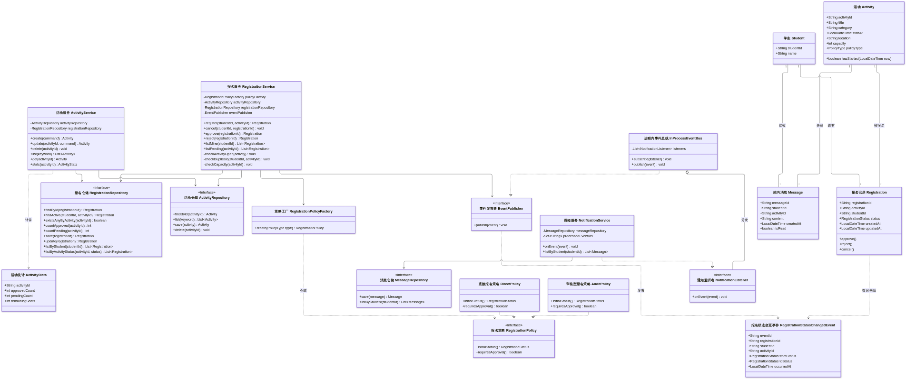
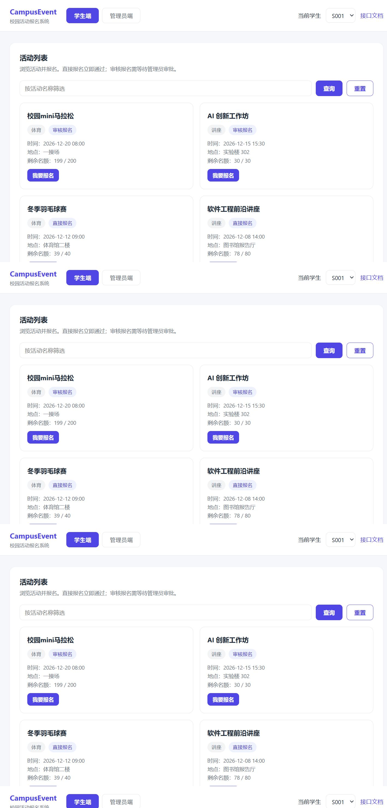
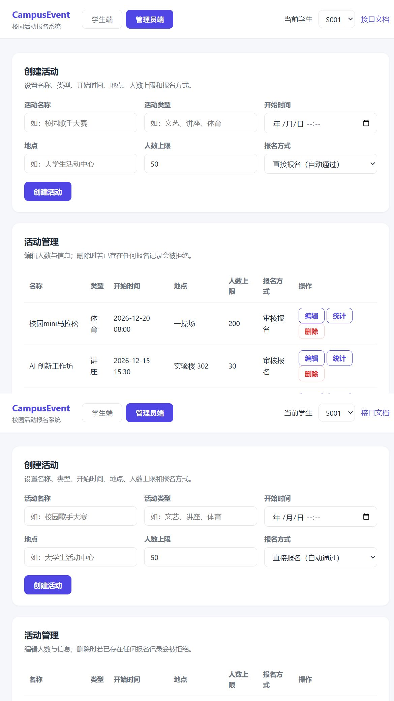

# 软件工程

## 实验二

### 基于设计模式的校园活动报名与管理系统（CampusEvent）

# 实验报告

| 班级 | 24计科2班 |
|---|---|
| 学号 | 242806010229 |
| 姓名 | 邹雅晴 |
| 提交日期 | 2026-11-22 |

代码仓库：https://github.com/yq-wcq/24jike2_242806010229_CampusEvent
线上地址：https://zyq.pythonanywhere.com

---

一、实验目标与需求范围

本次实验以"校园活动报名"为业务背景，走通"需求理解—设计先行—AI 辅助实现—测试验收—云端部署—变更准备"的完整流程，重点训练从需求中识别领域对象与职责边界、合理使用策略模式与观察者模式表达业务变化、在学生先做设计决策的前提下指导 AI 按设计完成实现与测试。系统实现 P2-F01 至 P2-F08：活动管理与查看、报名与取消、两种报名策略、审批操作、状态管理、站内通知、统计；对应指导书附录 B 的 B.2.1 至 B.2.7 业务规则。范围外功能明确不做：用户注册登录鉴权、消息队列异步任务、后续变更需求（指导书 3.6 规定教师发布变更单前不得提前实现）。验收依据为 C1—C10 及补充假设 T-S1、T-S2，验收记录见 tests/test_acceptance.py。

二、实现方案

开发环境为 Windows、Python 3.13、FastAPI、SQLite；测试使用 pytest 8.x。线上部署在 PythonAnywhere 免费实例，运行环境为 Python 3.12，WSGI 入口为 `wsgi.py`（FastAPI 是 ASGI 框架，手写了约 130 行的 ASGI→WSGI 适配器，WSGI 不触发应用启动钩子，因此入口脚本中显式执行数据库初始化与事件订阅）。

系统采用六层结构：路由层（`api/`）接收请求与参数校验 → 服务层（`services/`）实现报名、审批、活动管理、通知业务 → 策略层（`policies/`）实现直接报名与审核报名两种策略 → 事件层（`events/`）发布与订阅，解耦通知 → 仓储层（`repositories/`）接口加 SQLite 实现 → 领域层（`domain/`）定义实体、状态机、错误与事件契约。不使用 ORM，全部采用参数化 SQL。关键设计文档、UML 类图与时序图见 docs/设计说明V1.md。

| 模块 | 主要职责 | 关键设计 |
|---|---|---|
| `api/` | 13 个接口路由、参数校验、异常转 400 | 依赖倒置路由依赖服务，`include_router` 五组路由挂载 |
| `services/` | 报名校验、名额查重、审批复核、活动 CRUD、统计 | 策略选择后统一入口处理；名额校验只算已通过；事务先提交再发事件 |
| `policies/` | 直接报名返回已通过、审核报名返回待审核 | 工厂按活动配置选择；名额检查留在服务层（跨策略公共规则） |
| `events/` | 报名状态变更时发布事件、通知服务订阅写消息 | 观察者模式；事务边界保证通知失败不影响报名结果 |
| `repositories/` | 接口 + SQLite 实现，四张表 | 参数化 SQL；接口隔离便于测试注入 |
| `domain/` | 实体、状态机、错误、事件契约 | 四种状态合法转换校验；非法转换抛业务异常 |

策略模式决策：报名规则存在"直接通过"与"待审核"两种实现，抽象为 `RegistrationPolicy` 接口，`DirectPolicy` 返回已通过，`AuditPolicy` 返回待审核，工厂按活动配置选择。名额检查留在服务层而非策略中，理由有四：名额是跨策略的业务不变量、两种策略都必须满足；策略应保持无副作用，只决定初始状态；审批批准时需要复用同一套名额校验；后续新增策略不必重复实现名额逻辑。

观察者模式决策：报名状态变更时发布 `RegistrationStatusChangedEvent`，`NotificationService` 订阅并写站内消息，报名服务不依赖通知服务。事务边界为"业务事务先提交，提交成功后再发布事件"，满足 B.2.6 通知失败不影响报名结果；防重复通知依靠状态机守卫（非法状态转换直接拒绝，不发事件）、单一发布点（状态变更统一走 publisher）与事件编号去重三层措施。

类图、报名与审批时序图见 docs/设计说明V1.md。

*图 2-1 CampusEvent 初版 UML 类图：展示领域对象、服务、策略、事件与仓储之间的职责和依赖关系*

三、实施过程

指导书 3.3 设计任务 D 要求"设计材料须由其他学生评审签名确认后方可进入 AI 实现阶段"。本组在编码前完成了 SRS 分析、类图、时序图和设计模式决策报告，经同班同学评审通过并签名（见 docs/设计说明V1.md 第 11 节评审确认记录），确认 T-S1/T-S2 补充假设生效、策略/观察者选型合理、V1 接受并发和通知持久化等局限。

当前仓库将完整实现标记为 `baseline-v1`，作为初始验收与后续变更的基线。AI 主要参与骨架搭建、文档渲染、仓储实现、服务实现、测试编写与故障修复；设计决策（模式选择、名额放置、事务边界、删除策略）全部由学生先做再指导 AI 实现。关键协作事件、指令摘要、AI 产出及人工判断记录在项目根目录 AI_DEV_LOG.md，按六个阶段整理。按指导书 3.6 要求，变更需求须等待教师发布变更单后从 baseline-v1 创建分支实施。

四、测试结果

测试环境：Windows、Python 3.13、FastAPI、pytest 8.x、临时 SQLite。执行命令 `python -m pytest tests/ -q`，结果为 **23 passed，0 failed**。12 条验收用例（C1—C10 + T-S1/T-S2）与 4 条补充边界用例全部通过；每个用例使用独立临时数据库，重复执行结果一致。关键边界均有正向与异常路径覆盖：容量已满拒绝报名或批准、取消后名额释放、关闭并重新创建应用客户端后数据仍存在、通知失败不回滚报名、活动已开始仍允许取消报名、存在历史报名的活动删除被拒绝。缺陷修复记录含服务层剩余名额字段为空、Windows 文件锁、测试数据隔离、WSGI 入口错误、Python 版本不一致、通知静默失效、容量调整异常未映射为 400、编辑后剩余名额未刷新等。

| 用例 | 操作 | 预期 | 实际 | 结果 |
|---|---|---|---|---|
| C1 | 创建容量 2 的直接报名活动并查询详情 | 创建成功，剩余名额为 2 | 返回 201，活动可查询，剩余名额为 2 | 通过 |
| C2 | 学生 A 报名直接报名活动 | 状态已通过，名额减 1，生成通知 | 状态 APPROVED，剩余名额减 1，通过通知已写入 | 通过 |
| C3 | 学生 A 再次报名同一活动 | 拒绝重复有效报名，不新增记录 | 返回 400 和 DUPLICATE_REGISTRATION，仍只有一条记录 | 通过 |
| C4 | 容量 2 活动中 A、B 报名后 C 再报名 | A、B 通过，C 因满员失败 | C 返回 400 和 CAPACITY_EXCEEDED，剩余名额为 0 | 通过 |
| C5 | 学生 A 报名审核型活动 | 状态待审核，不占名额，生成等待通知 | 状态 PENDING，剩余名额不变，等待审核通知已写入 | 通过 |
| C6 | 管理员批准 A 的待审核报名 | 状态已通过，统计更新并通知 | 状态 APPROVED，已通过数为 1，通知已写入 | 通过 |
| C7 | 管理员拒绝另一待审核报名 | 状态已拒绝，不占名额并通知 | 状态 REJECTED，已通过数为 0，拒绝通知已写入 | 通过 |
| C8 | 容量 1 活动中批准 A 后再批准 B | B 批准失败并保持待审核，人数不超限 | B 返回 400，状态仍为 PENDING，已通过数保持 1 | 通过 |
| C9 | 分别取消已通过和待审核报名 | 状态已取消，已通过名额释放 | 两种取消均返回 204，统计与剩余名额同步更新 | 通过 |
| C10 | 关闭原客户端并创建全新客户端，再查询活动、报名和通知 | 重启后三类数据仍一致 | 三个 API 均返回原活动、APPROVED 报名及通过通知 | 通过 |
| T-S1 | 活动开始后新增报名，再取消原报名 | 禁止新增报名，但允许取消并释放名额 | 新增返回 ACTIVITY_STARTED，取消返回 204，名额释放 | 通过 |
| T-S2 | 删除有已取消历史报名的活动，再删除无报名活动 | 前者拒绝，后者允许 | 前者返回 DELETE_REJECTED，后者返回 204 | 通过 |
| B1 | 按名称关键字筛选活动 | 只返回名称匹配的活动 | 仅返回“校园马拉松”，其他活动被排除 | 通过 |
| B2 | 已取消、已拒绝后重新报名 | 允许新建报名并保留历史记录 | 均返回 201，生成新 ID，历史状态完整保留 | 通过 |
| B3 | 模拟通知写库异常后执行直接报名 | 报名成功且保留，失败写入日志 | 报名返回 201 且可查询，无消息记录，错误日志已留痕 | 通过 |
| B4 | 容量调小到低于已通过人数，再合法扩容 | 非法调整拒绝，合法扩容后重算剩余名额 | 调小返回 400 且数据不变；扩容返回 200，剩余名额正确 | 通过 |

五、结果分析

23 条测试覆盖了 C1—C10 + T-S1/T-S2、4 条补充边界场景、策略返回值、状态机非法转换、活动时间窗口和健康检查，核心功能均有正向与异常路径。临时数据库使测试可重复，避免“我这里是好的”。验收用例、测试输出与线上页面三处的功能描述一致。

线上验证了 `/health` 返回正常、活动列表渲染 5 个种子活动、报名与消息流完整闭环、Reload Web App 后数据仍存在，说明 SQLite 持久化有效。尚存局限：无身份鉴权（指导书规定不登录，属范围限定）、无并发控制（单机 SQLite 服务层校验无锁）、通知可能丢失（无事件表与重试机制）、取消不发通知（指导书未要求）、历史活动不可删（拒绝删除策略的代价）、前端为演示级无分页无前端校验（依赖后端校验）。以上均为基线版本的明确取舍，而非未发现的缺陷，教师发布变更单后部分局限可能在变更范围内解决。设计模式客观评估：策略模式在 V1 仅两种策略时收益有限，但一旦出现第三种报名方式优势立即显现；观察者模式在 V1 只有一个订阅者，但站内消息、邮件通知、统计采集都是天然独立订阅者。

六、问题与反思

问题 1：技术事实错误 — SQLite 部分索引。AI 在文档中写"SQLite 不支持部分索引"，实际自 3.8.0 版本后已支持。经核查后改为"V1 不采用数据库唯一索引兜底"，避免评审时被质疑。

问题 2：部署环境三重差异。线上 WSGI 不触发 ASGI lifespan 钩子、Python 版本与 venv 不一致、WSGI 入口文件指向旧项目 —— 三个独立问题叠加导致首次部署全部 502。最终分别用"显式 init_db + 事件订阅"、"重建 venv 统一 Python 3.12"、"替换 WSGI 入口"三个独立动作解决。

问题 3：业务规则必须落到可执行断言。"待审核不占名额"最初只写在文档里，直到写验收用例 C8（容量 1、先批准 P1 再批准 P2）才发现统计口径有歧义。最终明确统计只累加 APPROVED 状态，并在服务层和仓储层两处用例固定。

反思：AI 能快速给出结构和代码，但边界规则、范围控制和验收标准必须由人确定；提示词中写清"不做什么"和验证方式，比事后反复修补更有效。设计阶段把业务规则逐条翻译成代码断言（测试用例），是避免实现阶段返工的关键。部署环境与本地环境的差异是故障高发区，上线前必须准备最小验证命令。策略模式、观察者模式在本项目中不是为了"用了模式"而用，而是为了隔离变化点、让后续变更影响最小化。

七、附录

代码仓库：https://github.com/yq-wcq/24jike2_242806010229_CampusEvent
线上地址：https://zyq.pythonanywhere.com
启动方式：`python -m venv .venv` → 激活虚拟环境 → `pip install -r requirements.txt` → `python -m project.db` → `python -m uvicorn project.main:app --reload --port 8000`；测试命令：`pytest tests/ -v`。

相关文件：AI_DEV_LOG.md、docs/SRS分析.md、docs/设计说明V1.md、README.md、DEPLOY_PYTHONANYWHERE.md。

关键运行截图：

*图 A1 线上学生端 — 活动列表、我的报名、我的消息三个面板完整显示*

*图 A2 线上管理员端 — 创建活动表单、活动管理表格（可编辑/统计/删除）、待审核审批区域*
