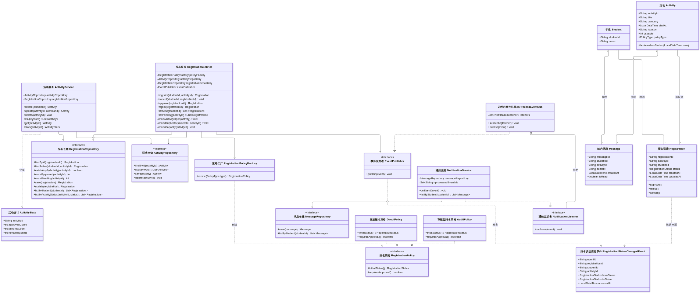
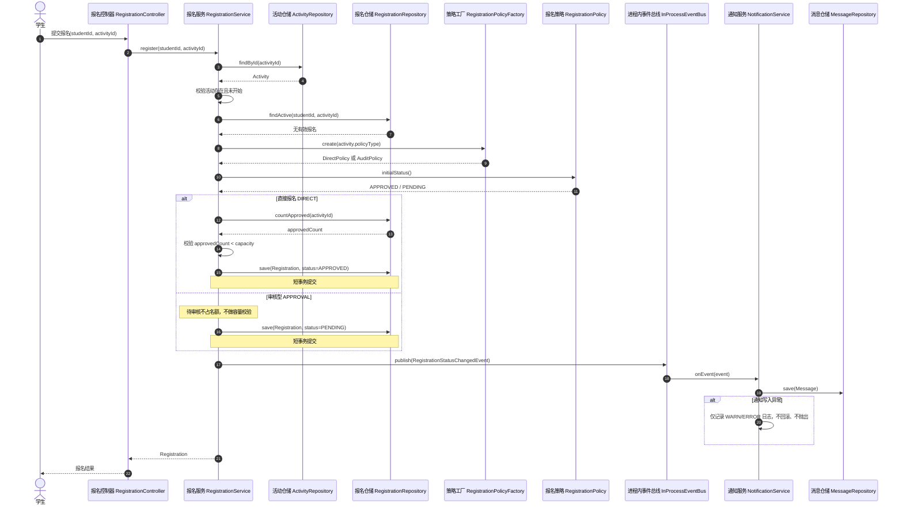
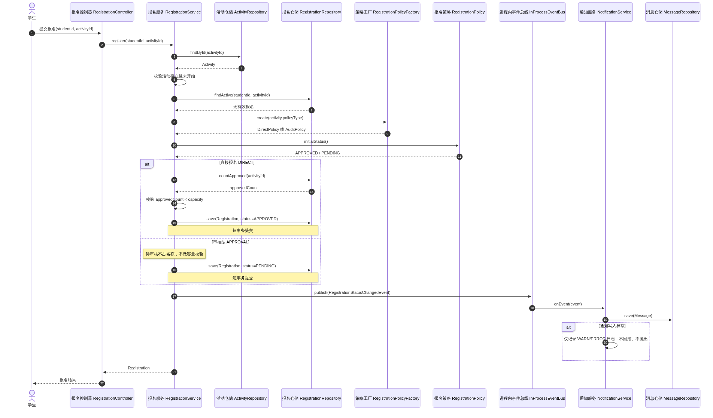
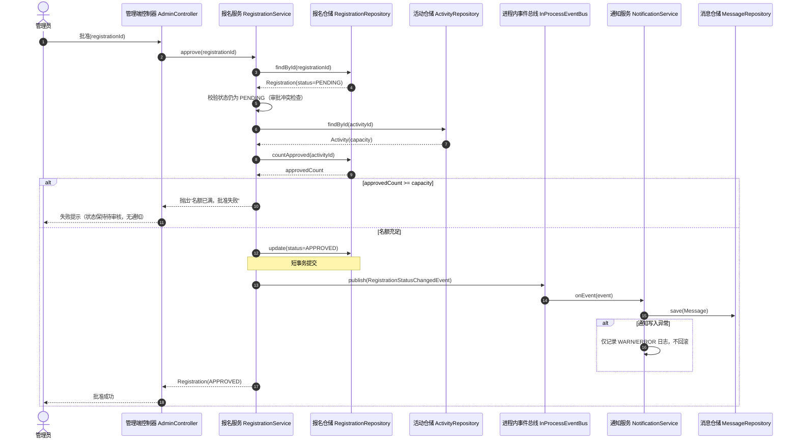
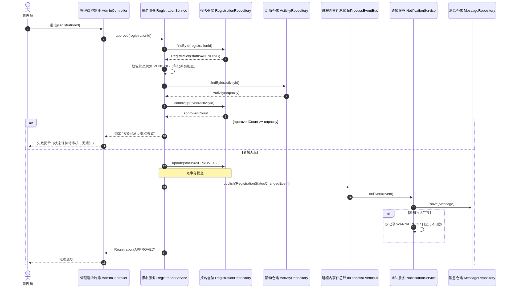

# 实验二 设计说明 V1（设计方案基线）

- 项目代号：**CampusEvent**
- 阶段：第 1 周设计任务 A/B/C/D 产出（编码前评审材料）
- 需求依据：[SRS分析.md](./SRS分析.md)、《实验二指导书》3.2、3.3、3.5、附录 B
- 技术前提：单体应用、单进程、SQLite 文件库；无消息队列；Admin 为内存模拟角色

---

## 1. 设计范围与前提

1. 只实现 P2-F01 ~ P2-F08，不实现第 2 周变更单（CR）中的任何内容。
2. 报名规则用策略模式表达；通知用进程内观察者/事件分发解耦；两者都不依赖外部中间件。
3. 数据一致性以 SQLite 短事务保证；名额校验与重复报名校验放在服务层。
4. 本文档中的接口名称、事件名、类名在编码阶段保持一致，便于评审与追踪。

---

## 2. 用例说明

### 2.1 参与者

| 参与者 | 说明 |
|---|---|
| Student | 演示学生账号（S001/S002/S003），无需登录 |
| Admin | 内存模拟管理员，不入库，无账号 ID |

### 2.2 用例清单

| 编号 | 用例 | 参与者 | 关联功能 | 关联验收用例 |
|---|---|---|---|---|
| UC-01 | 浏览与筛选活动 | Student | F02 | C1、C2 |
| UC-02 | 报名活动 | Student | F03、F04 | C2、C3、C4、C5 |
| UC-03 | 取消报名 | Student | F03、F06 | C9、T-S1 |
| UC-04 | 审批报名 | Admin | F05、F06 | C6、C7、C8 |
| UC-05 | 活动管理 | Admin | F01 | C1、T-S2 |
| UC-06 | 查看站内消息 | Student | F07 | C2、C6、C7 |
| UC-07 | 查看活动统计 | Admin / Student | F08 | C9 |

### 2.3 用例描述

**UC-01 浏览与筛选活动**

- 前置条件：已选择学生身份；数据库中存在活动。
- 主流程：学生打开活动列表 → 系统按开始时间升序展示活动 → 学生输入名称关键字 → 系统按标题模糊匹配返回列表 → 学生点击查看详情。
- 异常/规则：无匹配结果时返回空列表并提示；列表与详情只向学生展示“剩余名额”，不展示已通过数、待审核数。
- 后置条件：无数据变更。

**UC-02 报名活动**

- 前置条件：活动存在；`start_at > 当前时间`；该学生对该活动不存在 PENDING/APPROVED 记录。
- 主流程：
  1. 学生选择活动并点击报名。
  2. 系统校验活动存在、活动未开始、无重复有效报名。
  3. 根据 `policy_type` 选择报名策略：
     - 直接报名（DIRECT）：校验 `已通过数 < capacity`，创建“已通过”报名，提交事务后发布状态变更事件（产生站内消息）。
     - 审核型（APPROVAL）：不校验名额（待审核不占名额），创建“待审核”报名，提交事务后发布状态变更事件（产生站内消息）。
- 异常/规则：
  - 活动不存在 → 提示失败；
  - 活动已开始 → 拒绝新增报名；
  - 已存在 PENDING/APPROVED 报名 → 拒绝重复报名（C3）；
  - 直接报名名额已满 → 报名失败（C4）；
  - 已拒绝/已取消允许重新报名，新建一条记录。
- 后置条件：新增一条报名记录；直接报名产生一条站内消息。

**UC-03 取消报名**

- 前置条件：该名学生拥有该活动状态为 PENDING 或 APPROVED 的报名。
- 主流程：学生进入“我的报名” → 选择记录 → 取消 → 系统校验归属与状态 → 状态改为“已取消” → 若原状态为 APPROVED，名额立即释放。
- 异常/规则：
  - 非本人报名 → 拒绝；
  - 状态已是 REJECTED/CANCELLED → 拒绝；
  - 活动开始后仍允许取消（本组补充假设 T-S1）；
  - 取消不产生站内消息（V1 约定）。
- 后置条件：报名状态为 CANCELLED，统计同步变化（C9）。

**UC-04 审批报名**

- 前置条件：报名状态为 PENDING；操作者为管理员。
- 主流程：
  1. 管理员查看某活动的待审核列表。
  2. 批准：在同一事务内重新读取报名状态与已通过数 → 校验 `已通过数 < capacity` → 状态改为“已通过” → 提交 → 发布事件 → 生成通知。
  3. 拒绝：状态改为“已拒绝” → 提交 → 发布事件 → 生成通知。
- 异常/规则：
  - 名额已满 → 批准失败，状态保持待审核，不产生通知（C8）；
  - 报名已不是 PENDING（并发重复审批）→ 拒绝操作，不重复通知；
  - 批准/拒绝每次只允许成功一次。
- 后置条件：状态变更 + 一条站内消息。

**UC-05 活动管理**

- 前置条件：管理员身份。
- 主流程：创建/编辑活动（名称、分类、开始时间、地点、容量、报名方式）；删除无报名记录的活动。
- 异常/规则：
  - 容量必须为正整数；名称、时间、地点必填；
  - 调小容量不得小于当前已通过人数（本组补充假设）；
  - 活动下存在任意状态的报名记录（含已取消、已拒绝）→ 拒绝删除并提示（T-S2）；
  - 无报名记录 → 物理删除。
- 后置条件：活动数据变更或删除。

**UC-06 查看站内消息**

- 前置条件：已选择学生身份。
- 主流程：学生打开消息列表 → 按创建时间倒序展示本人消息（内容包含活动名称与结果）。
- 异常/规则：只返回 `student_id` 匹配的消息；is_read 字段仅预留，V1 不实现已读交互。
- 后置条件：无数据变更。

**UC-07 查看活动统计**

- 前置条件：活动存在。
- 主流程：管理员查看统计，展示已通过数、待审核数、剩余名额（`capacity − 已通过数`）。
- 异常/规则：学生端只显示剩余名额，不展示完整统计；取消、审批后统计实时变化（C9）。
- 后置条件：无数据变更。

---

## 3. UML 类图（初版）

> 类名为代码标识符，方括号内为中文显示名，保证图与 `project/` 代码一一对应。
> 渲染图输出在 `docs/images/`；修改源码后运行 `python scripts/render_diagrams.py` 重新生成。

```mermaid
classDiagram
    class Student["学生 Student"] {
        +String studentId
        +String name
    }

    class Activity["活动 Activity"] {
        +String activityId
        +String title
        +String category
        +LocalDateTime startAt
        +String location
        +int capacity
        +PolicyType policyType
        +boolean hasStarted(LocalDateTime now)
    }

    class Registration["报名记录 Registration"] {
        +String registrationId
        +String activityId
        +String studentId
        +RegistrationStatus status
        +LocalDateTime createdAt
        +LocalDateTime updatedAt
        +approve()
        +reject()
        +cancel()
    }

    class Message["站内消息 Message"] {
        +String messageId
        +String studentId
        +String activityId
        +String content
        +LocalDateTime createdAt
        +boolean isRead
    }

    class RegistrationPolicy["报名策略 RegistrationPolicy"] {
        <<interface>>
        +initialStatus() RegistrationStatus
        +requiresApproval() boolean
    }

    class DirectPolicy["直接报名策略 DirectPolicy"] {
        +initialStatus() RegistrationStatus
        +requiresApproval() boolean
    }

    class AuditPolicy["审核型报名策略 AuditPolicy"] {
        +initialStatus() RegistrationStatus
        +requiresApproval() boolean
    }

    class RegistrationPolicyFactory["策略工厂 RegistrationPolicyFactory"] {
        +create(PolicyType type) RegistrationPolicy
    }

    class RegistrationService["报名服务 RegistrationService"] {
        -RegistrationPolicyFactory policyFactory
        -ActivityRepository activityRepository
        -RegistrationRepository registrationRepository
        -EventPublisher eventPublisher
        +register(studentId, activityId) Registration
        +cancel(studentId, registrationId) void
        +approve(registrationId) Registration
        +reject(registrationId) Registration
        +listMine(studentId) List~Registration~
        +listPending(activityId) List~Registration~
        -checkActivityOpen(activity) void
        -checkDuplicate(studentId, activityId) void
        -checkCapacity(activityId) void
    }

    class ActivityService["活动服务 ActivityService"] {
        -ActivityRepository activityRepository
        -RegistrationRepository registrationRepository
        +create(command) Activity
        +update(activityId, command) Activity
        +delete(activityId) void
        +list(keyword) List~Activity~
        +get(activityId) Activity
        +stats(activityId) ActivityStats
    }

    class ActivityStats["活动统计 ActivityStats"] {
        +String activityId
        +int approvedCount
        +int pendingCount
        +int remainingSeats
    }

    class EventPublisher["事件发布者 EventPublisher"] {
        <<interface>>
        +publish(event) void
    }

    class InProcessEventBus["进程内事件总线 InProcessEventBus"] {
        -List~NotificationListener~ listeners
        +subscribe(listener) void
        +publish(event) void
    }

    class RegistrationStatusChangedEvent["报名状态变更事件 RegistrationStatusChangedEvent"] {
        +String eventId
        +String registrationId
        +String studentId
        +String activityId
        +RegistrationStatus fromStatus
        +RegistrationStatus toStatus
        +LocalDateTime occurredAt
    }

    class NotificationListener["通知监听者 NotificationListener"] {
        <<interface>>
        +onEvent(event) void
    }

    class NotificationService["通知服务 NotificationService"] {
        -MessageRepository messageRepository
        -Set~String~ processedEventIds
        +onEvent(event) void
        +listByStudent(studentId) List~Message~
    }

    class ActivityRepository["活动仓储 ActivityRepository"] {
        <<interface>>
        +findById(activityId) Activity
        +list(keyword) List~Activity~
        +save(activity) Activity
        +delete(activityId) void
    }

    class RegistrationRepository["报名仓储 RegistrationRepository"] {
        <<interface>>
        +findById(registrationId) Registration
        +findActive(studentId, activityId) Registration
        +existsAnyByActivity(activityId) boolean
        +countApproved(activityId) int
        +countPending(activityId) int
        +save(registration) Registration
        +update(registration) Registration
        +listByStudent(studentId) List~Registration~
        +listByActivityStatus(activityId, status) List~Registration~
    }

    class MessageRepository["消息仓储 MessageRepository"] {
        <<interface>>
        +save(message) Message
        +listByStudent(studentId) List~Message~
    }

    Student "1" -- "*" Registration : 拥有
    Activity "1" -- "*" Registration : 被报名
    Student "1" -- "*" Message : 接收
    Activity "1" -- "*" Message : 关联

    RegistrationService --> RegistrationPolicyFactory
    RegistrationService --> ActivityRepository
    RegistrationService --> RegistrationRepository
    RegistrationService --> EventPublisher

    ActivityService --> ActivityRepository
    ActivityService --> RegistrationRepository

    ActivityService ..> ActivityStats : 计算

    RegistrationPolicyFactory ..> RegistrationPolicy : 创建
    DirectPolicy ..|> RegistrationPolicy
    AuditPolicy ..|> RegistrationPolicy

    InProcessEventBus ..|> EventPublisher
    InProcessEventBus o-- NotificationListener : 分发
    NotificationService ..|> NotificationListener
    NotificationService --> MessageRepository

    Registration ..> RegistrationStatusChangedEvent : 数据来源
    EventPublisher ..> RegistrationStatusChangedEvent : 发布
```





*图 3-1　初版 UML 类图（由上方 Mermaid 源码渲染）*

说明：

- `Registration.reject()` 同时服务“管理员拒绝”，不额外拆分类。
- 枚举：`PolicyType {DIRECT, APPROVAL}`，`RegistrationStatus {PENDING, APPROVED, REJECTED, CANCELLED}`。
- 依赖方向：Controller → Service → Repository / Policy / EventPublisher；`NotificationService` 只依赖 `MessageRepository` 与事件，不反向依赖 `RegistrationService`，避免环依赖。
- 评审前补充：F02 浏览/筛选、F08 统计、UC-03“我的报名”、管理员待审核列表都需要查询入口，因此为 `ActivityService` 增加 `list/get/stats`，为 `RegistrationService` 增加 `listMine/listPending`，为 `RegistrationRepository` 增加 `countPending` 与两个列表查询。该补充只增加查询方法，不改变职责划分与依赖方向。

### 3.1 仓储接口方法说明

> Mermaid 类图不支持在方法行内附加注释，故用表格说明每个方法的用途。

**ActivityRepository（活动仓储）**

| 方法 | 中文说明 |
|---|---|
| `findById(activityId): Activity` | 根据活动编号查询单条活动记录 |
| `list(keyword): List<Activity>` | 查询活动列表；keyword 不为空时按活动名称模糊筛选（F02） |
| `save(activity): Activity` | 新增保存一条活动记录 |
| `delete(activityId): void` | 物理删除活动；仅当活动下无任何报名记录时由服务层调用（T-S2） |

**RegistrationRepository（报名仓储）**

| 方法 | 中文说明 |
|---|---|
| `findById(registrationId): Registration` | 根据报名编号查询单条报名记录 |
| `findActive(studentId, activityId): Registration` | 查询该学生在这个活动下有没有有效报名（用来查重，只认待审核/已通过） |
| `existsAnyByActivity(activityId): boolean` | 判断这个活动下是否存在任意报名记录（用于活动删除校验，不区分状态） |
| `countApproved(activityId): int` | 统计活动已批准报名人数（用来判断名额） |
| `countPending(activityId): int` | 统计待审核报名数量（F08 统计用） |
| `save(registration): Registration` | 新增保存一条报名记录 |
| `update(registration): Registration` | 更新报名记录（审批、修改状态时用） |
| `listByStudent(studentId): List<Registration>` | 查询学生自己的所有报名记录（我的报名） |
| `listByActivityStatus(activityId, status): List<Registration>` | 按活动 + 状态筛选报名，比如查某个活动的全部待审核记录 |

**MessageRepository（消息仓储）**

| 方法 | 中文说明 |
|---|---|
| `save(message): Message` | 保存一条站内消息（通知服务调用） |
| `listByStudent(studentId): List<Message>` | 查询某学生的站内消息，按创建时间倒序 |

### 3.2 服务方法说明

**RegistrationService（报名服务）**

| 方法 | 中文说明 |
|---|---|
| `register(studentId, activityId): Registration` | 报名：直接报名自动通过，审核型进入待审核 |
| `cancel(studentId, registrationId): void` | 取消报名：校验本人与状态；已通过取消后释放名额（T-S1 允许活动开始后取消） |
| `approve(registrationId): Registration` | 审批通过：事务内重新校验名额，满员则失败（C8） |
| `reject(registrationId): Registration` | 审批拒绝：仅待审核状态可拒绝 |
| `listMine(studentId): List<Registration>` | 查询学生自己的全部报名记录 |
| `listPending(activityId): List<Registration>` | 查询某活动的全部待审核报名 |

**ActivityService（活动服务）**

| 方法 | 中文说明 |
|---|---|
| `create(command): Activity` | 创建活动：校验名称、时间、地点、容量与报名方式 |
| `update(activityId, command): Activity` | 编辑活动：调小容量不得小于当前已通过人数（本组补充假设） |
| `delete(activityId): void` | 删除活动：有任何历史报名则拒绝，否则物理删除（T-S2） |
| `list(keyword): List<Activity>` | 活动列表与名称筛选（F02） |
| `get(activityId): Activity` | 活动详情（F02） |
| `stats(activityId): ActivityStats` | 活动统计：已通过数、待审核数、剩余名额（F08） |

### 3.3 领域模型与枚举说明

**Student（学生）**

| 字段/方法 | 中文说明 |
|---|---|
| `studentId` | 学号，也是演示账号（S001/S002/S003） |
| `name` | 学生姓名 |

**Activity（活动）**

| 字段/方法 | 中文说明 |
|---|---|
| `activityId` | 活动编号 |
| `title` | 活动名称（F02 按此字段模糊筛选） |
| `category` | 活动分类 |
| `startAt` | 开始时间；到达该时间后禁止新增报名（B.2.5） |
| `location` | 活动地点 |
| `capacity` | 人数上限，必须为正整数 |
| `policyType` | 报名方式：直接报名 / 审核型 |
| `hasStarted(now)` | 判断活动是否已开始，用于报名时间窗口校验 |

**Registration（报名记录）**

| 字段/方法 | 中文说明 |
|---|---|
| `registrationId` | 报名编号 |
| `activityId` | 所属活动编号 |
| `studentId` | 报名学生学号 |
| `status` | 报名状态：待审核 / 已通过 / 已拒绝 / 已取消 |
| `createdAt` | 创建时间 |
| `updatedAt` | 最后更新时间 |
| `approve()` | 待审核 → 已通过；非法状态抛出异常 |
| `reject()` | 待审核 → 已拒绝 |
| `cancel()` | 待审核/已通过 → 已取消；已通过取消后释放名额 |

**Message（站内消息）**

| 字段 | 中文说明 |
|---|---|
| `messageId` | 消息编号 |
| `studentId` | 接收学生学号 |
| `activityId` | 关联活动编号 |
| `content` | 消息正文（报名结果/审核结果） |
| `createdAt` | 创建时间 |
| `isRead` | 已读标记；V1 只保留字段，不实现已读交互 |

**ActivityStats（活动统计）**

| 字段 | 中文说明 |
|---|---|
| `activityId` | 活动编号 |
| `approvedCount` | 已通过人数（占用名额） |
| `pendingCount` | 待审核人数（不占名额） |
| `remainingSeats` | 剩余名额 = capacity − approvedCount |

**PolicyType（报名方式枚举）**

| 枚举值 | 中文说明 |
|---|---|
| `DIRECT` | 直接报名：提交后立即通过，受名额限制 |
| `APPROVAL` | 审核型报名：提交后进入待审核，管理员批准才占名额 |

**RegistrationStatus（报名状态枚举）**

| 枚举值 | 中文说明 |
|---|---|
| `PENDING` | 待审核：不占名额，不能重复报名 |
| `APPROVED` | 已通过：占用名额，不能重复报名 |
| `REJECTED` | 已拒绝：可重新报名 |
| `CANCELLED` | 已取消：可重新报名，原名额已释放 |

---

## 4. 时序图

### 4.1 报名流程（直接报名 / 审核型报名）





*图 4-1　报名流程时序图（直接报名 / 审核型报名）*

### 4.2 管理员审批批准时序图





*图 4-2　管理员审批批准时序图*

---

## 5. 设计模式决策

### 5.1 策略模式：报名规则

**抽象**

```text
RegistrationPolicy（接口）
  + initialStatus(): RegistrationStatus   // 报名提交后的初始状态
  + requiresApproval(): boolean           // 是否需要管理员审批

DirectPolicy  : initialStatus = APPROVED, requiresApproval = false
AuditPolicy   : initialStatus = PENDING,  requiresApproval = true
```

**选择方式**：`RegistrationPolicyFactory.create(activity.policyType)` 根据活动配置返回实现；`RegistrationService` 只依赖 `RegistrationPolicy` 接口，主流程中不出现 `if (policyType == DIRECT)` 之类的分支。

**名额检查放在 RegistrationService（公共服务层）的理由**

1. **名额是跨策略的公共不变量**：B.2.3 对两类活动都成立，直接报名和审批批准都必须遵守；若下放到策略，每个未来新增策略都要重复实现，容易出现口径不一致。
2. **策略保持无状态、无副作用**：策略只回答“初始状态是什么”，不访问数据库、不做并发控制，便于单元测试；容量统计属于持久化查询，放在策略中会迫使策略依赖 Repository，违背职责单一。
3. **审批动作同样复用同一校验**：`approve()` 在事务内重新 `countApproved + checkCapacity`，与直接报名共用 `checkCapacity`，保证 C8 与 C4 行为一致。
4. **未来扩展点清晰**：若出现“候补/优先报名”等策略，只需新增策略实现，公共校验无需改动（OCP）。

**边界处理**：

- 直接报名：先校验容量再落库；失败不产生报名记录（C4）。
- 审核型报名：提交时不校验容量（待审核不占名额）；批准时才校验（C8）。
- 重复报名：`findActive` 查询 PENDING/APPROVED，服务层统一拦截（C3）；REJECTED/CANCELLED 不阻断重新报名。

### 5.2 观察者 / 事件分发：解耦通知

**事件契约**

```text
RegistrationStatusChangedEvent（报名状态变更事件）
  eventId: UUID                              // 事件唯一编号，用于通知去重
  registrationId / studentId / activityId    // 报名编号 / 学生学号 / 活动编号
  fromStatus / toStatus                      // 变更前状态 / 变更后状态
  occurredAt                                 // 事件发生时间
```

**结构**

- `RegistrationService` 在状态变更事务提交后调用 `EventPublisher.publish(event)`；
- `InProcessEventBus` 实现 `EventPublisher`，维护 `NotificationListener` 列表并同步分发；
- `NotificationService` 实现 `NotificationListener`，根据 `toStatus` 生成消息文案并写入 `MessageRepository`。

**事件触发点（V1）**

| 状态变化 | 是否发事件 | 是否写消息 |
|---|---|---|
| 无 → 已通过（直接报名） | 是 | 是 |
| 无 → 待审核（审核型报名） | 是 | 是 |
| 待审核 → 已通过（审批） | 是 | 是 |
| 待审核 → 已拒绝（审批） | 是 | 是 |
| 待审核/已通过 → 已取消 | 否 | 否（SRS 约定 V1 不通知） |

**事务边界（明确结论）**

1. 业务事务**先提交**：报名/审批的数据库写入包在短事务内，提交成功后才发布事件。
2. 通知在事件处理阶段执行，**不参与业务事务**；通知异常由 `NotificationService` 捕获，仅记录 `WARN/ERROR` 日志。
3. 因此通知失败**不会回滚**报名记录，也不会向前端抛出业务失败（符合 B.2.6）。
4. 反向风险：事务提交后、事件发布前进程崩溃会丢失通知。V1 接受该风险（无消息队列、无重试），在报告中如实说明。

**防止重复通知**

1. **状态机守卫**：只有合法状态转换才发事件；已通过的报名不能再次批准，重复审批请求在状态校验处即失败。
2. **单一发布点**：每个业务动作只在 `RegistrationService` 对应方法内发布一次事件，Controller 和 Repository 不发布。
3. **事件幂等键**：`NotificationService` 用 `processedEventIds` 集合按 `eventId` 去重，重复投递同一事件不会重复写消息。
4. **无自动重试与无队列**：V1 不存在重放源，避免“失败重试放大”导致重复消息；将来引入重试时保留 `eventId` 幂等机制即可。

---

## 6. SOLID 原则应用

| 原则 | 在本设计中的体现 |
|---|---|
| 单一职责 SRP | `RegistrationService` 只编排报名/取消/审批流程；`RegistrationPolicy` 只决定初始状态；`NotificationService` 只写消息；Repository 只负责持久化；`ActivityService` 只负责活动 CRUD |
| 开闭原则 OCP | 新增报名规则只需新增 `RegistrationPolicy` 实现并注册到工厂，`RegistrationService` 不修改；通知渠道变化只需新增 `NotificationListener` |
| 里氏替换 LSP | `DirectPolicy`、`AuditPolicy` 对 `RegistrationPolicy` 契约完全可替换，服务层不感知具体类型 |
| 接口隔离 ISP | `RegistrationPolicy`、`EventPublisher`、`NotificationListener`、各 Repository 均为窄接口，客户端不依赖无关方法 |
| 依赖倒置 DIP | 服务依赖 `EventPublisher`、`RegistrationPolicy`、Repository 抽象；`InProcessEventBus`、SQLite Repository 为实现细节，可在测试中替换为内存实现 |

---

## 7. 设计取舍（收益与成本）

### 7.1 策略模式

**收益**

- 报名规则与主流程分离，新增规则不改 `RegistrationService`，符合第 2 周变更的可扩展目标；
- 两条规则可独立单元测试，边界条件（初始状态）集中且可枚举；
- 名额等公共规则集中在服务层，口径统一，避免策略各自实现导致偏差。

**成本**

- 增加 1 个接口、2 个实现、1 个工厂，V1 只有两种规则，代码量与跳转层级高于简单 `if/else`；
- 阅读主流程时需跳到工厂与实现类才能看到完整行为，调试路径变长；
- 若未来规则差异极大（例如需要不同的校验顺序），抽象可能需要重新设计。

### 7.2 观察者 / 事件分发

**收益**

- 报名业务不依赖通知实现，通知失败不影响主流程，事务边界清晰；
- 新增通知渠道（如站内 + 邮件）只需新增订阅者，不改报名服务；
- 事件作为审计与测试切入点，便于断言“发生了什么”。

**成本**

- 引入事件、发布者、总线、监听者四类结构，V1 只有一个订阅者，存在过度设计风险；
- 同步分发下通知写库耗时会进入请求链路（虽不回滚）；
- 无持久化事件表，不保证“提交后必达”，需在报告中如实说明这是有意的 V1 简化。

**结论**：在课程要求“用可测指标说明扩展性、并如实报告模式成本”的前提下，保留两种模式，但在报告中记录上述成本，不把“使用了设计模式”当作优点结论。

---

## 8. 活动删除策略

**选定方案：存在报名记录则拒绝删除，无报名记录则物理删除。**

- 判定条件：`RegistrationRepository.existsAnyByActivity(activityId)`，**不区分状态**（含已取消、已拒绝），因为 B.2.4 要求保留历史报名记录。
- 存在记录：返回业务错误“该活动已有报名记录，无法删除”，活动与报名均保持不变（T-S2）。
- 无记录：执行物理删除。
- 理由：
  1. V1 不引入 `is_deleted` 字段，不需要在所有查询与统计中加过滤，改动面最小；
  2. 从根上避免历史报名与统计丢失，C10 的数据一致性不受影响；
  3. 删除是低频管理操作，拒绝策略对主流程无影响。
- 代价：一旦产生过报名，该活动将永远不能被删除，只能保留展示；若后续需要归档，应在变更阶段引入软删除，不在 V1 预设。

---

## 9. 与验收用例的对应

| 设计点 | 覆盖用例 |
|---|---|
| 直接报名策略 + 服务层名额校验 | C1、C2、C4 |
| 服务层重复报名校验 | C3 |
| 审核型策略 + 审批容量复核 | C5、C6、C7、C8 |
| 取消状态机与统计同步 | C9 |
| SQLite 持久化 + 重启一致性 | C10 |
| 活动开始后仍可取消（假设） | T-S1 |
| 有历史报名则拒绝删除（假设） | T-S2 |

---

## 10. 存在问题与风险（评审时需确认）

1. **并发超额风险**：V1 采用“先查后写”的进程内校验 + 短事务，单实例下可接受；多实例或高并发下需乐观锁/条件更新，不在 V1 范围，报告中需说明。
2. **通知不保证必达**：事务提交后、事件发布前崩溃会丢消息，V1 无事件表、无重试；符合“通知失败只留日志”的业务底线，但不是可靠通知。
3. **管理员无审计**：Admin 不入库，审批记录不带操作人；B.1 未要求，V1 接受。
4. **活动不可清理**：拒绝删除策略导致历史活动长期留存；如需归档需后续变更引入软删除。
5. **取消不发通知**：SRS 已约定，若评审要求补充，需要新增“取消”事件与消息文案。
6. **时间与时区**：`start_at` 以 `Asia/Shanghai` 本地时间存储与比较，跨时区部署需统一 UTC，当前不涉及。
7. **指导书未给事件契约与消息文案**：本文档自定义 `RegistrationStatusChangedEvent` 与消息模板，需评审确认后冻结，编码阶段不得随意改名。
8. **策略/观察者在 V1 的复杂度成本**：规则仅两条、订阅者仅一个，模式收益要在第 2 周变更时用数据验证；当前不宣称其“更优”。

---

## 11. 评审确认记录

> 依据《实验二指导书》3.3 设计任务 D：设计材料须由其他学生评审通过并签名确认后，方可进入 AI 实现阶段。

评审人：李梦璐

评审日期：2026-11-20

评审确认项：

1. 确认 SRS 全部本组补充假设生效：T-S1 活动开始允许取消报名、T-S2 拒绝删除带历史报名的活动；
2. 确认审核报名提交（待审核状态）触发站内消息；
3. 确认 V1 接受以下设计局限：内存事件去重、进程崩溃丢失通知、单机并发假设、历史活动不可删除；
4. 确认本套类图、接口、时序图冻结，后续编码严格遵循本设计，不允许 AI 随意改动结构。

评审意见：需求范围与业务规则表述清晰，类图职责划分合理，报名与审批时序完整；策略模式将报名规则与公共名额校验分离，观察者模式明确了通知事务边界及失败处理方式。T-S1、T-S2 补充假设具有对应验收用例，V1 的并发、通知可靠性和历史活动保留等局限已如实说明，同意冻结本版设计并进入实现阶段。

评审结论：☑ 通过　□ 有条件通过　□ 不通过

