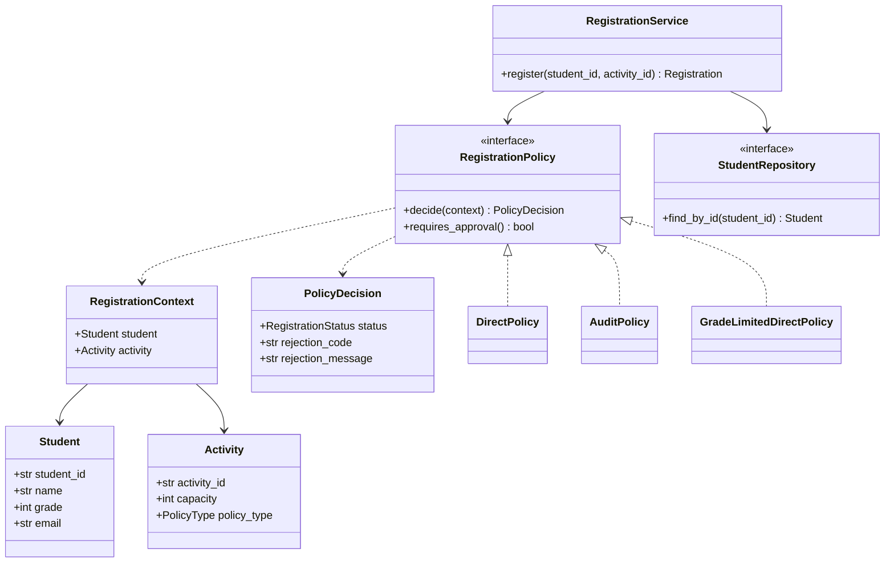
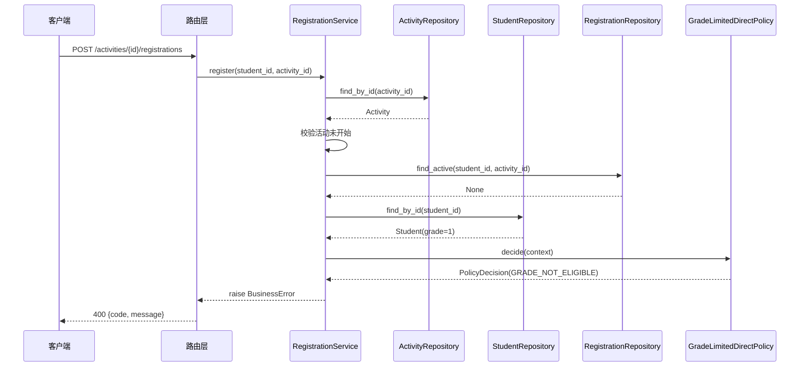
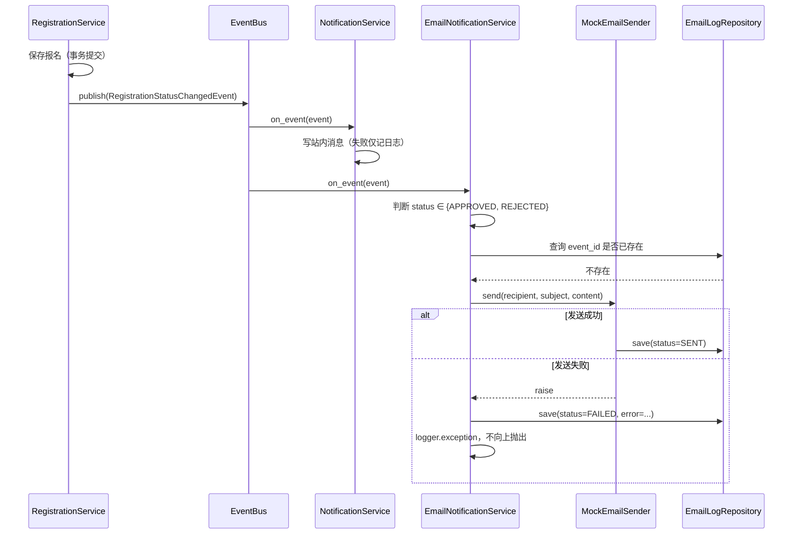

# 设计说明 V2（增量设计：CR-01 / CR-02）

## 一、设计目标与原则

本次变更对应教师材料中的 CR-01（年级限定直接报名）与 CR-02（站内消息之外的模拟邮件通知）。设计遵循四条原则：

- 公共约束集中：活动存在、活动未开始、重复报名、名额上限、状态机校验仍只在一个地方实现。
- 变化点隔离：年级资格属于特定活动的规则，放进策略；邮件属于通知渠道，放进订阅者。
- 事务边界不变：仍然是“业务提交成功后再发布事件”，通知失败不回滚业务。
- 行为兼容：原有直接报名、审核报名、站内消息的行为与返回结构保持不变。

## 二、受影响结构总览



新增的部分集中在三处：策略契约从“返回状态”变为“给出决策”；`Student` 获得年级与邮箱；新增学生仓储供服务层读取资格信息。原有类名、分层和依赖方向不变。

## 三、CR-01 年级限定直接报名

### 3.1 职责分配

| 规则 | 归属 | 理由 |
|---|---|---|
| 活动必须存在 | 服务层 | 与报名方式无关的前置条件 |
| 活动未开始不允许报名 | 服务层 | 跨策略公共约束（B.2.5） |
| 同一学生不得重复有效报名 | 服务层 | 跨策略公共约束（B.2.4） |
| 只有已通过占名额 | 服务层 | 跨策略公共约束（B.2.3） |
| 报名后进入什么状态 | 策略 | 直接通过 / 待审核的差异点 |
| 年级是否具备报名资格 | 策略 | 只对年级限定活动生效的规则 |
| 状态迁移合法性 | 领域模型 | 与报名方式无关的不变量 |

这张表是本次设计的核心：年级资格不是公共约束，因此不能写成服务层里的 `if activity.is_grade_limited`；否则每增加一种活动规则，`register` 就会多一个分支。

### 3.2 策略契约

```python
@dataclass(frozen=True)
class RegistrationContext:
    student: Student
    activity: Activity

@dataclass(frozen=True)
class PolicyDecision:
    status: RegistrationStatus | None = None
    rejection_code: str | None = None
    rejection_message: str | None = None

class RegistrationPolicy(Protocol):
    def decide(self, context: RegistrationContext) -> PolicyDecision:
        """返回初始状态，或返回拒绝原因；不得访问仓储、不得写库。"""
    def requires_approval(self) -> bool:
        ...
```

策略保持无副作用：只根据传入上下文判断，不查询数据库、不发布事件。决策对象由服务层解释：有拒绝码就转成 400，没有就继续原来的名额校验与保存流程。

选择决策对象而不是让策略抛异常，是因为策略不应了解 HTTP 语义与错误响应格式；拒绝码让服务层继续作为唯一的异常到状态码映射点。

### 3.3 三种策略的行为

| 策略 | 条件 | 返回 |
|---|---|---|
| `DirectPolicy` | 无附加条件 | `status=APPROVED` |
| `AuditPolicy` | 无附加条件 | `status=PENDING` |
| `GradeLimitedDirectPolicy` | `student.grade ∈ {2,3}` | `status=APPROVED` |
| `GradeLimitedDirectPolicy` | 其他年级 | `rejection_code=GRADE_NOT_ELIGIBLE`，提示“该活动仅面向大二、大三学生” |

前两种策略只是把原来的 `initial_status()` 改写为返回决策对象，判定逻辑与返回值完全等价，由原有用例保证行为不变。

年级集合固定在策略内部，因为 CR-01 的规则就是“仅大二、大三”。若将来需要按活动配置不同年级范围，扩展点在策略构造函数，不需要改服务层；这是有意保留的演进路径，而不是现在就引入配置表。

### 3.4 报名流程（拒绝路径）



通过路径在策略返回 `APPROVED` 后，继续沿用 V1 的名额校验、保存与事件发布，顺序不变。

### 3.5 服务层接入点

`RegistrationService.register` 只增加三处动作：

- 在查重之后加载学生，学生不存在时返回 `STUDENT_NOT_FOUND`。
- 用 `policy.decide(RegistrationContext(student, activity))` 替换原来的 `policy.initial_status()`。
- 决策带拒绝码时抛出业务错误，否则按原逻辑处理状态与名额。

不改变的内容：约束顺序、名额只统计 APPROVED、保存后再发布事件、`approve` / `reject` / `cancel` 的流程。

### 3.6 兼容性

- 原有直接报名仍返回 APPROVED，审核报名仍返回 PENDING，C1—C10 的断言语义不变。
- 活动创建与编辑接口的 `policy_type` 是枚举，新增枚举值即被接受，老客户端不受影响。
- 学生表新增列有默认值，已有报名记录不受影响。

### 3.7 未采用的方案

不采用“规则链 + 组合规则”：当前只有一条资格规则，引入规则接口、组合器与执行顺序会显著增加概念数量，收益要到出现多条规则时才体现。若后续出现年级、学院、会员等级等规则，重构点在 `PolicyDecision` 的生成过程，服务层接入点不变。

## 四、CR-02 模拟邮件通知

### 4.1 订阅者扩展

| 监听者 | 订阅事件 | 处理范围 | 失败策略 |
|---|---|---|---|
| `NotificationService`（V1） | 报名状态变更 | APPROVED / PENDING / REJECTED 写站内消息 | 记日志，不抛出 |
| `EmailNotificationService`（新增） | 报名状态变更 | APPROVED / REJECTED 写模拟邮件 | 记日志并记录 FAILED，不抛出 |

按 CR 文字“报名通过、审核通过或拒绝”，邮件只覆盖 APPROVED 与 REJECTED；PENDING 仍只发站内消息，避免改变原有通知语义。

`RegistrationService` 与 `NotificationService` 均不修改，事件仍在业务提交之后发布，这是观察者模式在本次变更中的直接收益。

### 4.2 邮件端口与 Mock 实现

```python
class EmailSender(Protocol):
    def send(self, *, recipient: str, subject: str, content: str) -> None:
        """发送失败时抛出异常，由订阅者捕获。"""

class MockEmailSender:
    """不连接真实邮件服务，只把发送结果交给仓储持久化。"""
```

`MockEmailSender` 在调用 `EmailLogRepository.save(...)` 时写入收件人、主题、内容、状态与时间；真实邮件、SMTP 配置与重试机制均不在本次范围。

失败注入只存在于测试：用会抛异常的发送器替换 Mock，验证“报名成功、邮件失败、错误留痕”。

### 4.3 邮件通知时序



### 4.4 事务边界与失败隔离

业务事务在发布事件之前已经提交，因此邮件与站内消息的任何异常都不可能回滚报名结果。订阅者在自己的边界内捕获所有异常：邮件失败只产生一条 FAILED 记录和一条错误日志，接口仍返回报名成功。

这一约定与 V1 的 B.2.6 设计一致，本变更不引入分布式事务，也不把邮件发送前置到保存之前。

### 4.5 去重设计

| 方案 | 覆盖范围 | 重启后有效 | 说明 |
|---|---|---|---|
| V1 内存集合 | 单进程、当前生命周期 | 否 | 简单，但重启丢失 |
| V2 数据库唯一约束 | 单库、所有进程 | 是 | `email_logs.event_id UNIQUE` |

`EmailNotificationService` 在发送前检查事件是否已记录，写入时依赖唯一约束兜底；重复事件触发冲突后直接跳过并记录日志。这样即使同一事件被重复发布，也不会生成第二封邮件。

取舍：失败记录同样占用该 `event_id`，因此同一事件不会自动重试。V2 不实现重试队列，失败即留痕，符合本次验收要求；重试属于后续演进。

### 4.6 装配与部署差异

新增依赖装配：

- `get_student_repository()`、`get_email_log_repository()`、`get_email_sender()`、`get_email_service()`。
- `main.py` 的 `lifespan` 订阅邮件监听者。
- `wsgi.py` 同样订阅——WSGI 不触发 FastAPI 启动钩子，漏掉这一处会表现为“本地有邮件、线上没有”。

部署验收标准：线上完成一次直接报名后，`email_logs` 必须出现一条 SENT 记录，站内消息同时存在。

### 4.7 查询接口

新增只读接口 `GET /api/admin/email-logs`，按创建时间倒序返回最近记录，字段包含收件人、主题、状态、错误与时间。该接口只用于验收与课堂演示，不参与任何写路径。学生端消息接口保持不变。

## 五、数据设计增量

### 5.1 学生表

```sql
ALTER TABLE students ADD COLUMN grade INTEGER NOT NULL DEFAULT 2
    CHECK (grade BETWEEN 1 AND 4);
ALTER TABLE students ADD COLUMN email TEXT NOT NULL DEFAULT '';
```

演示数据：S001 大二、S002 大三、S003 大一、S004（新增）大四，各自带示例邮箱。已有三条学生记录保留，年级按上述映射回填。

### 5.2 活动表

`policy_type` 的 CHECK 需要从两个值扩展为三个值。SQLite 不支持修改 CHECK，采用重建表：

```sql
CREATE TABLE activities_new (
    activity_id TEXT PRIMARY KEY,
    title       TEXT NOT NULL,
    category    TEXT NOT NULL DEFAULT '',
    start_at    TEXT NOT NULL,
    location    TEXT NOT NULL,
    capacity    INTEGER NOT NULL CHECK (capacity > 0),
    policy_type TEXT NOT NULL
        CHECK (policy_type IN ('DIRECT', 'APPROVAL', 'GRADE_DIRECT'))
);
INSERT INTO activities_new SELECT * FROM activities;
DROP TABLE activities;
ALTER TABLE activities_new RENAME TO activities;
```

重建期间关闭外键、重建索引，结束后执行 `PRAGMA foreign_key_check` 并核对行数。迁移脚本幂等：通过 `sqlite_master` 判断约束是否已包含新值，已迁移则跳过。

### 5.3 邮件记录表

```sql
CREATE TABLE email_logs (
    email_id        TEXT PRIMARY KEY,
    event_id        TEXT NOT NULL UNIQUE,
    registration_id TEXT NOT NULL,
    student_id      TEXT NOT NULL,
    recipient       TEXT NOT NULL,
    subject         TEXT NOT NULL,
    content         TEXT NOT NULL,
    status          TEXT NOT NULL CHECK (status IN ('SENT', 'FAILED')),
    error           TEXT,
    created_at      TEXT NOT NULL
);
CREATE INDEX idx_email_logs_created_at ON email_logs (created_at);
```

测试库由 `reset_db` 按新 SCHEMA 直接建表，`DELETE` 顺序需要把 `email_logs` 纳入，避免用例间串数据。

## 六、接口契约增量

| 接口 | 变化 |
|---|---|
| `POST/PUT /api/admin/activities` | `policy_type` 新增 `GRADE_DIRECT`，其余字段不变 |
| `POST /api/activities/{id}/registrations` | 新增失败码 `GRADE_NOT_ELIGIBLE`、`STUDENT_NOT_FOUND`，成功响应不变 |
| `GET /api/admin/email-logs` | 新增只读接口 |
| 其余报名、审批、消息、统计接口 | 不变 |

错误响应保持既有格式 `{"code": "...", "message": "..."}`，不引入新的响应包装。

## 七、前端增量

- 活动创建与编辑的两个下拉框增加“年级限定直接报名（仅大二、大三）”。
- `POLICY_TEXT` 增加 `GRADE_DIRECT` 的中文文案，活动卡片与表格同步展示。
- 演示学生选择处标注年级，便于课堂演示不合格提示。
- 管理员端增加邮件记录面板，展示收件人、状态、时间与错误信息；学生端消息面板不变。

## 八、测试设计

新增两个测试文件，与教师验收表逐条对应：

| 用例 | 测试要点 |
|---|---|
| CR1-01 / CR1-02 | 大二、大三报名年级限定活动返回 201 且 APPROVED |
| CR1-03 / CR1-04 | 大一、大四返回 400、`GRADE_NOT_ELIGIBLE`，包含原因 |
| CR1-05 | 全量重跑 C1—C10 保持通过 |
| CR2-01 | 直接报名后站内消息与 SENT 邮件各一条 |
| CR2-02 | 批准、拒绝分别产生对应渠道记录 |
| CR2-03 | 注入失败发送器后报名成功、邮件 FAILED、错误日志存在 |
| CR2-04 | 同一事件重复发布后邮件记录仍为一条 |
| CR2-05 | 全量重跑 C1—C10 保持通过 |

测试注意点：fixture 需清理新增仓储缓存；邮件去重依赖数据库唯一约束，`reset_db` 清表即可；失败注入通过替换邮件服务依赖或直接构造带失败发送器的订阅者完成，不修改生产代码分支。

此外补充 4 条公共约束测试：年级合格但名额已满、重复报名、活动已开始、学生不存在，用于证明年级规则没有绕过原有校验。

全量目标：原有 23 条加新增 14 条，共 37 条全部通过，回归失败数为 0。

## 九、设计取舍与已知局限

- 独立策略而非规则链：当前一条资格规则，规则链属于过度设计；扩展点已留在策略内部。
- 决策对象而非策略抛异常：保持策略无副作用、无 HTTP 语义，服务层仍是唯一边界。
- 数据库去重而非内存集合：覆盖重启，代价是失败事件不会自动重试。
- 不接真实邮件、不做重试队列、不持久化事件表：属于本次范围外，与 V1 的已知局限一致。
- 并发控制仍沿用 V1 的单机假设：名额校验与报名写入之间没有锁，本次变更不扩大也不缩小该局限。

## 十、与 V1 的差异清单

| 文件 | V1 | V2 |
|---|---|---|
| `policies/base.py` | `initial_status()` / `requires_approval()` | `decide(context)` / `requires_approval()`，新增上下文与决策对象 |
| `policies/direct.py`、`audit.py` | 返回状态 | 返回决策对象，行为等价 |
| `policies/grade_limited.py` | 不存在 | 年级限定直接报名策略 |
| `domain/models.py` | Student 仅 id、name | 增加 grade、email |
| `repositories/` | 无学生仓储 | 新增 StudentRepository 与 EmailLogRepository |
| `services/registration_service.py` | 策略决定初始状态 | 加载学生、调用决策、处理拒绝；流程与事务边界不变 |
| `services/email_service.py` | 不存在 | 邮件订阅者与 Mock 发送器 |
| `db.py` | 四张表、两个策略值 | 学生加列、活动重建、新增 email_logs |
| `main.py` / `wsgi.py` | 订阅站内通知 | 同时订阅邮件监听者 |
| `static/index.html` | 两种报名方式 | 增加年级限定选项与邮件记录面板 |

## 十一、实施顺序与验收对应

实施顺序：本文档 → 数据层与迁移 → 策略契约与年级策略 → 报名服务接入 → 邮件订阅者与装配 → 新增测试 → 全量回归 → 线上迁移与部署 → `change-v2` 标签 → 实验报告与 AI 记录补充。

验收对应：CR-01 由 CR1-01~05 覆盖并回归 C1—C10；CR-02 由 CR2-01~05 覆盖并回归 C1—C10；两项变更共同以 37 条测试与线上 `email_logs` 记录作为证据。

## 十二、结论

CR-01 与 CR-02 都能在既有分层内落地：前者通过升级策略契约把“资格判断”隔离到策略层，后者通过新增观察者把“邮件渠道”隔离到通知层。报名服务的公共约束、事务边界与对外契约保持稳定，变更影响集中在策略、学生数据、邮件记录与装配四处，可回归、可对比、可回滚。
